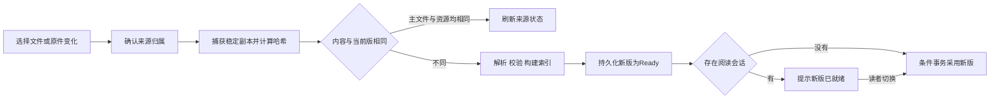

# 导入与原件自动更新重设计

日期：2026-11-18。状态：**用户已授权实施，主流程已落地；实际范围与验证见第11节。**

本计划替代[综合计划](2026-11-18-听书预热多音色与内容笔记互通.md)中的导入方案，听书和笔记互通仍按综合计划另行实施。

用户已确定：**修改原文件，Folio自动识别更新；后台准备新版，阅读中提示切换，未打开时自动采用。** 因此“手动重新导入/更新内容”保留为补救入口，日常保存原件不要求额外操作。

## 1. 核心决策

采用“**关联原件＋稳定书目＋固定阅读版本**”。

- 原件由用户管理：保留文件名、位置和编辑方式，Folio不改写它。
- 书目代表用户正在读的这本书：稳定身份承载书架、集合、笔记和阅读记录，不随文件路径或内容哈希改变。
- 阅读版本是Folio捕获并验证的副本：当前阅读只使用这一版，原件保存到一半不会破坏正在读的章节。
- 原件变化后自动准备下一版：未打开时自动采用；有阅读会话时留作“新版已就绪”，由读者切换。

| 选择 | 编辑原件后的体验 | 阅读一致性与代价 | 本期判断 |
| --- | --- | --- | --- |
| 继续一次性复制导入 | 要手动找新文件，容易新增书卡 | 稳定，但来源与书目脱节 | 不作为默认 |
| 直接读取原路径，不保留副本 | 保存后立刻读新文件 | 文件正在写入、断连或移动时容易与索引混版 | 不作为默认 |
| **关联原件并保存阅读版本** | 保存原件即可，按阅读状态采用新版 | 每个真实新版本需一次捕获，换取稳定阅读与离线能力 | **推荐** |

文件哈希继续做完整性与重复内容判断，但不再承担书目的身份。相同标题/作者不构成同一本书的证明。

## 2. 用户实际会遇到的行为

| 场景 | 默认结果 |
| --- | --- |
| 首次选择`我的书.epub` | 创建一张书卡，记住原件，捕获可读版本；原文件不改名 |
| 编辑原件并保存，书没打开 | 后台校验成功后自动更新同一张书卡，提示更新结果 |
| 编辑原件并保存，正在阅读或听书 | 保持当前版本，显示“新版已就绪”；可继续读或切换 |
| 保存后立即打开书，新版还在准备 | 先打开最后可读版本，准备好后提示；不拿旧章表读新字节 |
| 再次导入同一个已关联原件 | 内容未变则无操作；内容变化则走同书更新，不再新增书卡 |
| 另一位置存在同样字节 | 唯一命中时复用书卡并记录备用来源；不自动抢走主更新来源 |
| 同名但内容不同、没有来源关联 | 作为新书；元数据相似可提示候选，不自动覆盖 |
| 主原件删除、移动后无法识别，或权限失效 | 最后阅读版本继续可用，显示“原件不可用”，提供重新关联 |
| 原件被保存成损坏文件、加密口令变化或内容不完整 | 保留当前版本和所有阅读数据；显示原因，之后可重试 |
| 从Folio移除书目 | 停止跟踪该来源，保留外部原件；监听不自动把刚移除的书加回来 |

“关联原件”表示读者将该文件的后续保存作为这本书的版本。程序无法从文字变化绝对判断用户是否把另一部作品存到了同一路径；格式变更、出版物标识冲突、目标内容已属于另一张书卡时进入冲突处理，不偷偷合并笔记。只改书名不会移动文件或产生内容版本。

首期同一内容默认只有一张书卡、可有多个本地来源；不提供“同字节但两份独立进度/笔记”的副本功能。已有历史重复书目保留，遇到多候选要求选择，不在迁移时自动合并。

## 3. 文件名与存放方式

用户平时打开和修改的是原件，默认“打开文件位置”指向原件。导出副本沿用原文件名，必要时安全处理重名。Folio内部新版本也保留可读叶文件名，例如：

```text
用户文件夹/我的书.epub                         ← 用户编辑，Folio只读
Folio存储目录/versions/<book_uuid>/<rev_no>/我的书.epub
Folio存储目录/.staging/<operation_id>/...     ← 尚未发布的候选
```

UUID与版本目录只为避免身份/命名冲突，不把它们显示成书名；哈希存数据库和版本清单，不要求叶文件名必须是哈希。存储目录与原件目录必须区分，内部目录排除出来源监听，防止自我导入。

旧库不启动批量搬家或改名，原哈希路径先作为Legacy版本兼容读取。首次受控更新时再发布新布局，成功后按引用关系清理旧文件。停止沿用“通过副本父目录猜书库根”的方式，封面、缩略图、备份恢复与清理从明确的存储根/版本资产引用取路径。

## 4. 最小数据模型

| 对象 | 必要职责 | 明确不承担的职责 |
| --- | --- | --- |
| Book | 新增稳定book_uuid，保留原整数book_id；当前版本、用户书名/集合等 | 不用路径、书名或哈希当书目主键 |
| Source | 本机来源ID、book_id、路径或持久URI、访问能力、主/备用、观察代数与状态 | 不把原件绝对路径或系统授权凭据同步给其它设备 |
| Revision | 本书内rev_no、内容SHA-256、快照路径、解析代、资源清单、准备状态 | rev_no只作本机顺序/并发检查，不作跨设备时钟 |
| 阅读数据 | 稳定记录ID、书目归属、原始建锚版本；各版本的位置映射 | 不因正文更新就覆盖原引文或把旧坐标改标为新版本 |
| 导入操作 | 操作ID、来源观察代、预期当前版本、阶段及本次拥有的产物 | 不另建通用命令总线或长期任务平台 |

Source与Revision分离：同一来源可以产生多版，同一版可能来自多个位置。多个来源只选一个主更新源；备用源内容分叉不会轮流覆盖书目。主源失联时不擅自把备用源提为主源，重新关联由用户明确决定。

解析算法/分章规则升级使用独立index generation，同字节重建索引不伪装成用户更新了原文件，但可能改变章节坐标。建锚来源、会话、异步结果和写入检查都携带(revision, index_generation)或等价坐标代；不能仅验证内容hash就放行旧章号写入。书内设置和用户编辑的书名不能被新版解析出的元数据覆盖；内容标题与用户覆盖字段分别处理。

## 5. 一条共享管线处理首次导入与更新



### 发现变化

- 文件监听只产生“需要检查”事件，不直接修改书目；同源连续保存合并，新的观察代数使旧任务失效。即使事件到来时长度/mtime相同，也不能直接认定没变。
- 启动、恢复前台和来源重新可达时在后台对账。开书做轻量来源检查，同时立即读取已有阅读版本；不在每次开书同步全文件哈希。
- watcher丢事件、网络盘/提供方不给可靠版本时，使用有IO预算的后台内容复核和手动“检查更新”。无事件且长度、时间均未变的改写只能在内容复核时发现，不承诺即时检测。
- 不把“两次尺寸相同”当作写入已完成的证明。等待写入安静期、检查前后文件事实、捕获并校验；捕获期间再次变化就重试。没有写者协调/文件系统快照时，不能严格证明捕获等于原件某个瞬间的完整状态，持续变化或解析不通过时保持旧版。
- 改名/原子保存用平台文件身份、文件事件与内容证据关联；inode/file ID只是线索，不能单独作为永远不变的书身份。无法确认时保留书目并请求重新关联。

### 捕获与发布

1. 来源适配器读取主文件，分块写入本次独占暂存，同时计算SHA-256；复制、哈希合为一次流式读取。沿用现有取消/进度和任务优先级。
2. 解析只读暂存版，生成候选章表、资源、封面及建锚所需结构；这个阶段不持Store锁。
3. 检查来源观察代是否仍最新；自包含文档比较主文件完整hash，带资源文档必须连同已捕获资源清单及各资源内容hash比较，全部相同才结束。资源单独变化也产生新revision，不能因主文件hash相同跳过资源检查；旧代候选不能覆盖较新的准备结果。
4. 以原子禁止覆盖方式发布快照/清单，再用一次事务登记完整Ready版本。已有文件冲突验证身份或另取本次独占目标，不能check-then-rename覆盖。
5. 采用新版时比较expected active revision与最新来源代；事务更新当前版本和兼容读字段，重复采用无副作用。并发打开阅读会话与自动采用使用同一会话租约/采用协调点，不能仅用一次UI布尔读取判断“未打开”。
6. 当前会话切换前结清旧版进度、停止旧版听书请求，构建新版Document/Book；章节、布局、图像、封面与字体请求带版本标记，旧结果丢弃。多窗口有任一该书会话时不自动采用。

旧会话写入必须有expected_revision及expected_index_generation：旧进度只留旧坐标代，未提交笔记明确保存到旧建锚版本或提示重试，不会悄悄进入新版。同内容重建索引也执行会话切换与旧写隔离；只有本地坐标代映射验证后，才按原同步坐标契约输出。仅在回调上丢旧结果不足以保护数据库。

### 各来源和格式的差别

- 本地原件有持久访问能力时默认关联跟踪。传书、普通URL下载、剪贴板文件和一次性移动分享默认独立导入副本；不能拿临时路径充当长期来源。
- Android当前选择器只返回cache副本，需平台把原URI、持久授权结果和本地临时副本分开返回；提供方不支持时明确显示“已导入副本，无法自动跟踪原件”，保留手动选择新版入口。iOS按实际安全作用域能力处理，不从Android成功推断iOS也可跟踪。
- EPUB/PDF/TXT等自包含文件捕获主文件即可。HTML/Markdown等相对图片、CSS、字体依赖由格式层枚举、core在用户授权来源范围内限额捕获；revision包含资源清单指纹，不能只hash主文件就声称所有内容没变。外链网络资源不在导入时自动下载。无法捕获的依赖明确报告，不能把动态原件资源混入已标记稳定的阅读版本。
- 资源bundle参与变更监听、导出、备份和版本校验；当前v1文件同步只表达单文件，同一主hash的不同bundle不能合成同一准确版本桶。首期该类本地版本及笔记明确标记跨端能力限制，不输出伪造的v1精确定位；bundle跨端包装和交换能力单独验收，不能仅传主文件就报完整同步成功。

## 6. 笔记、进度与旧同步如何继续工作

正文自动更新不要求每条旧笔记都重新确认，但也不能静默改变笔记的事实归属：

- 原始引文、原锚点、原建锚版本保持；新版位置作为派生映射，有精确/可靠重定位/待关联状态。
- 对同一已关联原件的受控更新，精确引文及足够上下文唯一匹配可以显示为“已重定位”；歧义不选第一处、不贴章首，笔记仍在该书笔记页可读。用户在H1修正位置时持久保存H1映射，不改H0原锚点及v1发布桶；真正重新划选范围作为明确新记录处理，不能把同uid悄悄改成另一个版本的范围。
- 外部阅读器导入且无法证明同修订的笔记仍按综合计划预览确认，不能把“原件自动更新”的授权扩大成“任意外部笔记自动跨版关联”。
- 新版进度依据精确位置或上下文映射；无法可靠定位时保留旧进度并让读者选落点，不用百分比冒充精确恢复。旧版的已读状态与新内容完成度分开，用户明确标记的状态不无声改写。

第一期不重写整个同步协议，但必须同时改正确v1投影：

| 记录 | v1收发规则 |
| --- | --- |
| 在H0内容创建的笔记/书签uid | 一直在H0桶收发；显示到H1的派生位置不改变原uid的锚点/hash |
| 在H1新建的笔记 | 在H1桶收发；不塞回H0 |
| 删除旧uid | 墓碑发回该uid的原内容桶；删除后导入不默认复活 |
| 阅读位置 | 按内容版本分开；H0远端进度不挪动H1当前进度 |
| 书内设置 | 同书一份设置值和逻辑版本，向已知各版本桶镜像时不抬版本；任一桶的输入都与该书全局设置版本按既有稳定顺序合并，避免旧桶无条件覆盖或镜像反复制造更新 |

Store保存hash→本书历史revision/记录归属映射；旧文件已回收也保留必要身份和墓碑元数据。禁止继续把book_id下所有记录装到`books.content_hash`当前值里；这项兼容桥在自动更新启用前验收，不能以长期暂停同步当交付。

v1不携带逻辑书UUID关系，因此全新设备只有H1时不能自动知道H0是它的历史版本。首期准确同步各内容版本，自动聚合版本关系、跨设备继承旧版本笔记、同字节独立书卡属于后续v2关系元数据设计。遇到目标hash已属于另一书卡或旧库多个归属时先保持旧版并提示冲突，不强行合并或覆盖v1桶。

## 7. 失败、空间与清理

- 准备失败、磁盘满、原件不可读、加密口令变化、解析超限：当前版不变，新操作可重试；旧密码按hash保存的兼容入口需要在新字节验证成功后才重新绑定。
- 操作阶段和产物所有权写入本机日志。崩溃后清理本操作未发布暂存；已发布未登记的快照经引用核对回收；Ready/Active从数据库恢复。已有新写入后不能因后续失败自动退回旧版。
- Reader只读Folio的版本副本，Folio不原地改其字节。外部硬链接会共享写入，不能用来替代复制；可选reflink需平台能力和验证，属于后续优化。用户直接改内部副本不作为编辑入口，发现损坏时保全旧记录并从原件重建，不能继续混版。
- 默认保留当前版、上一个可恢复版本、任何被阅读会话占用的版本；更旧未引用字节按明确空间策略清理，原锚点/引文与版本标识不随字节删除。空间不足不能先删当前/活动版来凑本次更新。
- 磁盘预算按原件、全部保留/会话占用版本、在途候选及资源/索引的总量估算，并限制全局并发捕获与在途字节；“原件＋旧版＋新版”只是简单单次场景，不是最坏上界。未变内容不新增版本，不为每次打开再复制。大书准备在后台并展示进度，支持取消，不能把“无等待”扩写成“零IO、零额外存储”。
- 从书架移除时外部原件永不删除；来源抑制记录防监听自动复活。永久删除用户笔记另有明确操作，快照清理只处理应用拥有且无引用的资产。

## 8. 迁移与工程边界

先追加迁移，保留现有book_id和公共路径兼容入口；新的book_uuid、Source、Revision和记录归属逐步填充。旧`books.path`的UNIQUE不能拿来表示多个逻辑书共享路径；首期不引入这种新状态。

旧书只有原副本路径，没有可证明的原件关联：不从导入日志文件名猜路径。已有字节与登记hash一致时建立可读Legacy版本；不一致或文件缺失时保留旧索引/旧hash的`legacy-unverified`归属，把实际字节作为新候选，不能把全部旧锚点回填到当前实读hash。只有可信旧版本可继续阅读；未验证或缺失时保证书目/笔记可读及重新关联入口，不用旧章表配变化后的字节兜底，候选校验解析成功后再恢复正文。更新时才进入新布局，不全库强制重新导入。

职责继续沿用现有crate：format负责文档解析和相对资源说明；core/ingest统一捕获、准备、采用与恢复编排；store负责事务/查询/归属；model只放多crate共用的数据；app services协调监听和会话，host/platform提供文件/URI能力。新增事件不允许services调用reader内部函数。先按真实职责拆`pipeline.rs`，不因长度创建新的业务框架。

备份恢复同步纳入同批迁移：备份当前可读版本、所保留历史、笔记原锚点与来源描述；本机文件授权凭据不跨机器复用，恢复后来源为待重关联，但当前阅读版仍可读。清理器以登记的版本/操作所有权为依据，停用对新布局不适用的“按16位文件名猜孤儿”规则。现有旧备份继续可恢复。

## 9. 实施次序与完成标准

| 包 | 实施内容 | 通过标准 |
| --- | --- | --- |
| A | 原子无覆盖发布、真实内容判重；把现有覆盖探针转回归 | 编辑后重导旧字节不能覆盖；同短名并发、磁盘失败、取消不删旧文件 |
| B | Book/Source/Revision迁移、一次捕获哈希、Ready/Active事务、v1按revision投影 | 老库/旧备份可读；旧记录不误标新hash；崩溃重试幂等，主源关系明确 |
| C | 来源观察、防旧代发布、会话租约与切换、旧写隔离、资源/缓存失效 | 未打开自动采用、打开中提示；连续保存只采用最新；多窗口/听书/迟到写不串版本 |
| D | 来源失联/改名/重新关联、移动权限、空间回收、可读命名与导出 | 原件不改名不删除；失联仍可读；内部不自我监听；权限降级可解释 |
| E | 组合验收与文档 | 导入→编辑→自动更新→笔记定位→同步→备份恢复全链可复现 |

关键组合用例：相同mtime/长度有事件仍检查，丢事件后后台复核；原件缩短和时间回拨；写入中断；更旧准备任务后完成；切换或同内容重建索引与旧进度/笔记写交错；来源原子替换/改名；主备用内容分叉；相同hash候选冲突；重复引文/删章/emoji定位；主文件不变而图片资源单独变化；旧uid墓碑仍回原hash；书内设置经多hash桶往返不抬版本；历史字节清理后笔记保留；移动授权撤回；备份恢复后不读取旧机器原件路径。

性能分别测首开/再次开书、后台更新耗时、IO字节数、峰值内存与磁盘；相同字节重复导入无新增快照/书目，普通开书不等待原件全量校验。真实平台事件、文件句柄/授权、无头交互和构建分开留证据。实现期间只跑受影响用例，按用户推送授权再跑全量。

## 10. 与上一方案相比的取舍

这次直接调整导入的主模型：首次导入和原件更新走同一条管线；日常编辑后自动准备，书卡身份稳定，原件关联可见，文件名保持可读。手动替换只是没有持久来源或发生冲突时的补救。

用户两项偏好已确认，后续“帮我开始修改代码”已授权本专项实施。听书多音色与外部笔记交换是综合计划的独立工作包，不以本次导入改造宣称完成。

## 11. 实施记录与证据边界

- **身份与持久化**：追加v32迁移，保留整数book_id并补稳定UUID、Source、Revision及原锚点归属；准备/采用单事务，Ready不可重写，旧候选和旧主来源任务失效。书目、来源、批注与书签的整数ID不再复用，覆盖跨重启和同步插入；撤销拒绝覆盖不同UID，防止删除后迟到操作误写新对象。历史无哈希或字节不符的记录保持未验证，不能自动重标到新内容哈希。
- **捕获/发布**：新管线覆盖普通导入与归档内书，复制时计算SHA-256，内部发布禁止覆盖，支持不具备硬链接能力的文件系统。可读叶名放独占版本目录，源文件不搬动；一次性替换成功准备后暂停旧来源，重新关联只在Ready成功后事务切换主来源。
- **自动更新**：每App/Store独立SourceMonitor和SourceReconciler，原生事件＋元信息检查＋120秒轮转审计，限制每轮处理和探测数量；相同元信息有事件仍检查，缩水/时间回拨也检查。未打开自动采用；读取租约存在时提示新版，多窗口不会强行切走其它会话。支持进度、取消和原件不可用/冲突状态。
- **Android**：系统选择结果尝试保留只读SAF授权并记录原URI；再次读取核验持久授权，按独占文件描述符交给核心分块捕获。授权失败保一次性副本。首次选择仍包含系统桥的URI→cache拷贝，后续更新直接从URI读取；不宣称首次只有一遍总IO。
- **固定阅读与派生位置**：版本文档装配不依赖Store实现。TXT/Markdown的规范章节写在版本目录，SQLite仍只存索引；章节产物按长度和hash校验，改变分章规则不重解旧版本。全书唯一引文/上下文命中才产生派生位置，不改变原记录锚点和同步身份，无法定位的笔记原文保留。旧坐标代写入、旧搜索/图像回调不能写入新会话。
- **同步/恢复/清理**：旧hash桶和位置分开，远端重锚先使旧投影失效；未知旧锚点不继承新hash。备份数据库与版本文件pin同锁取得，恢复迁移全部版本路径并将来源标记待重关联。清理保护当前、上一版、阅读/备份租约；永久失效的旧Ready允许回收，同代临时不可读候选保留；旧平铺清扫也认历史版本引用。删除书目先提交数据库再处理文件，持租文件保留。

已执行的定向证据包括：Store迁移/内容/版本/来源代数/旧写与同步投影/恢复回归；核心导入、归档、扫描、监听、资源、URI能力、Ready复用及GC回归；`import_revision_contract`验证原件更新→阅读旧版→切换→笔记原桶同步→完整备份恢复；`reindex_contract`与引擎边界契约；GPUI真实切换/取消/多窗口/删除保护和受影响阅读/笔记/目录回归。最终编译与治理命令结果随本次交付记录，未因本次实施运行推送全量。

最终验收使用根Cargo.lock与Rust 1.99.0，Cargo命令均带`--offline --locked`：

- Store版本回归15例、记录版本/身份回归6例，以及批注14例、书签6例、同步10例、迁移10例通过。
- 核心导入领域91例通过；末轮另复验历史回收，确认失效候选在释放pin前保留、释放后清理，当前版和最新Ready文件仍存在。导入组合契约1例、重索引2例、模块依赖契约1例通过。
- GPUI新增来源版本交互、旧帧同版本号换书删除回归及受影响目录/批注/书签测试通过；目录原有墙钟用例仍忽略。
- 受影响六crate的`clippy --all-targets -- -D warnings`通过；Android arm64 API26严格Clippy与dev原生链接通过，Java系统文档桥编译通过。
- `fmt --check`、`git diff --check`、`governance --base main`、`boundaries`与`release-check`通过；没有新增超限文件或边界例外。未提交、推送或制作发布包。

边界按实际能力保留：

1. 原生文件事件不是完整文件系统审计；无事件且元信息完全相同的改写由有界轮转复核发现。无法确定的移动/改名提供重新关联，不凭文件名猜身份。
2. HTML/Markdown相对资源在授权源目录内限额捕获，超限/越界/暂不支持的引用形状明确失败，保留旧版；系统单文档URI没有相对目录授权时不能把未取得的资源声称为已固定。
3. v1无法表达同主文件的资源bundle或不兼容索引代，相关部分在同步界面提示暂不互通并保留本机数据，不伪造准确坐标。v2跨设备版本关系尚未加入。
4. 正文、来源和读取权限保全优先。书目已移除但曾被租约保护的历史目录可能留待后续显式清理，不通过扫描未知目录强删。
5. Java编译、Android API26 Rust检查/链接与无头交互不等于系统提供方实机验收。本次没有安装或操作手机，真实授权撤销、云文档提供方与平台性能仍需单独实测。
